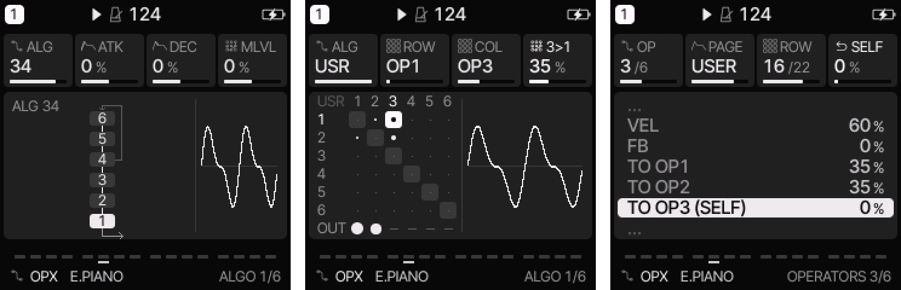

# Felucca-OPX

**Felucca-OPX** is custom firmware for the M-VAVE FM-1: [Felucca](https://github.com/hugelton/Felucca) 1.5.1, the
multi-engine synthesizer firmware by Hügelton Instruments, with one more engine, **OPX**, an altered-FM engine
after the Korg opsix. Everything Felucca does is here unchanged; OPX is added beside it.

This is an unofficial fork. Please report its problems [here](https://github.com/thomasgregorymarsden-code/Felucca-opx/issues),
not to Felucca's authors, who did not write the OPX engine.

- **Install:** connect the FM-1 by USB, open the [web installer](https://thomasgregorymarsden-code.github.io/Felucca-opx/)
  in Chrome or Edge and press Install. No extra hardware is needed. Read [Before you install](#before-you-install)
  first. The installer's **Return to official V15** goes back to M-VAVE's firmware.
- **Try it first:** [Felucca-OPX in your browser](https://thomasgregorymarsden-code.github.io/Felucca-opx/webapp/try/),
  the same firmware compiled to WebAssembly, with the panel on screen (mouse, touch, computer keyboard, Web MIDI in).
- **Editor:** [web editor](https://thomasgregorymarsden-code.github.io/Felucca-opx/webapp/editor/) (Felucca's; it has
  no page for OPX's operators yet).
- **Releases:** [Releases](https://github.com/thomasgregorymarsden-code/Felucca-opx/releases) (packages and
  checksums), [CHANGELOG.md](CHANGELOG.md).
- **Build:** [BUILDING.md](BUILDING.md). Every push is built and tested by GitHub Actions.

Installing custom firmware is at your own risk.

## Before you install

- **Projects and user presets without an OPX track** move between Felucca 1.5.1 and Felucca-OPX both ways.
- **A project with an OPX track opens only on Felucca-OPX.** On Felucca or the official firmware its slot shows
  EMPTY; the data stays in flash until something is saved into that slot there. The same holds for a user preset of
  an OPX sound, and for the autosave (RESTORE LAST) when it holds an OPX track.
- **User sample slot 3 holds 40 KB** (about 3.7 s) instead of 80 KB: the OPX patches use the other half. A longer
  sample already in slot 3 must be uploaded again, shorter or into slot 1 or 2. Slots 1 and 2 are unchanged.
- **OPX patches** are kept with projects, the autosave, user presets (up to 16 OPX user presets; a 17th is refused
  with "OPX PRESETS FULL" until one is erased or saved over) and the editor's full backup. An OPX user preset saved by
  0.1.0 or earlier has no patch of its own and comes back with its SLOT's factory patch.
- **Updating from 0.1.0:** the first start moves the projects' OPX patches into the 0.2 layout, once; nothing else
  changes. Installing 0.1.0 again afterwards loses the projects' OPX patches (their tracks play the SLOT's factory
  patch), not the projects.
- **Kept when installing:** projects, user presets, samples, settings and MIDI LEARN assignments.
- **Coming from an older Felucca:** Felucca's own warnings apply. Projects saved by 1.4 or later do not open on
  1.1.5.x, and projects saved by 1.5 or later do not open on 1.2 to 1.4.1. See
  [Felucca's release history](docs/FELUCCA_HISTORY.md).

## The OPX engine

OPX is modelled on the opsix's operator section: six operators per voice, routed by an algorithm, each with its own
mode, waveform, pitch, level, envelope and key tracking, and the pitch envelope EG1 and LFO1 with their routes to
the operators' pitch and level. It plays up to six voices. The opsix's EG2, EG3, LFO2, LFO3, main filter, effects and
virtual patch are not implemented yet ([plan](docs/OPX_PLAN.md)).

To use it, hold **EDIT** and press **A3**, the third white key from F3 (ANALOG, FM6, OPX, …; the layer's map shows
them). PRESETS lists its seven factory sounds: E.PIANO, BELL, FM BASS, BRASS, SAW LEAD, LOOP PAD and X-MOD.

### What it plays

- **Algorithms:** the opsix's 40 (1–32 are the DX7's, 33–40 the opsix's own) and **USER**, a 6 × 6 matrix: how much
  each operator modulates each other one (0–100 %), its self feedback on the diagonal, and which operators are heard.
  Algorithms 4, 6 and 34 have a feedback loop across operators, set by **ALG FB**.
- **Operator modes:** what an operator does with its oscillator and its input (the operators feeding it):
  - **FM:** the input modulates the oscillator's phase; FB (self feedback) and WIDTH.
  - **RING MOD:** the oscillator times the input; DEPTH (100 %: the ring alone, 0 %: the oscillator alone), SHAPE
    (rectifies the input: brighter).
  - **FILTER:** the input and the oscillator (OSC MIX) through a filter whose cutoff follows the operator's pitch;
    TYPE (LPF, HPF, BPF, BRF, MG LPF12/24, MG HPF12/24, MG BPF6/12, MS-20 LPF/HPF), CUTOFF (±50 semitones), RESO.
  - **FILTER FM:** the oscillator through the filter, the input moving its cutoff; TYPE, CUTOFF, RESO.
  - **WAVE FOLDER:** the input and the oscillator (OSC MIX), with BIAS, folded back GAIN times.
  - **EFFECT:** the input and the oscillator (OSC MIX) through one of ten effects with two values, E and F: PEAK EQ,
    SHELV EQ, PHASER, SHORT DELAY, COMB, DIST, DRIVE, DEC (sample rate and bits), WAVESHAPER, PUNCH.
  - **BYPASS:** the input passes as it is. **MUTE:** silent.
- **Per operator:** RATIO (1/128 to 32) or a FIXED frequency, FINE, DTUN (cents), TRANS (semitones), LEVEL, an
  ATK DEC SUS REL envelope with CURVE (LIN, 1–9, EXP), velocity to level (VEL), and **KTRK**: the level rising or
  falling with the distance from a CENTER key, separately below (LOW) and above (HIGH), each LIN or EXP.
- **Waveforms:** the opsix's 23: SIN, SIN 12BIT, SIN 8BIT, TRI, SAW, SAW HD, SQR, SQR HD, ADTV SAW3, ADTV SQR3,
  ADTV TRI3, ADTV 12345, ADTV 1+2 … 1+8 (the fundamental and one harmonic, like two organ drawbars), NOISE S/H
  (a random level held for each cycle of the operator), NOISE WHITE, PINK and BLUE. SAW and SQR are band-limited to
  10 kHz, the HD versions to 20 kHz. **WIDTH** (FM mode; OFF, 1–99 %) squeezes the whole wave into that part of each
  cycle and leaves the rest silent. A noise ignores pitch, FM, FB and WIDTH.
- **A patch** is all of that for six operators plus the algorithm. Each track has its own. SLOT F1–F7 loads a
  factory patch, **SLOT INIT** the INIT patch (as the opsix's INITIALIZE: OP1 alone at LEVEL 100, algorithm 1, ratio
  1, no modulation; turn past OWN to reach it); editing any value makes it the track's own (**SLOT OWN**).

### The pages

On an OPX track, EDIT goes **ALGO, OPERATORS, ENVELOPE, OP LEVELS, EG1-3, LFO1-3** and back: VOICE, VOICE 2 and VOICE 3 are OPERATORS' VOICE section on an
OPX track (the same parameters). Both OPX pages
show the algorithm in the left half: a chart of square operator boxes for a preset algorithm, the matrix for USER.

**ALGO** has the opsix's HOME knobs (ALG, ATK, DEC) and SLOT, with a small oscilloscope in the right half. The scope
shows two periods of the note the track is playing (or the last note played).

| Knob | A preset algorithm | USER |
|---|---|---|
| 1 | ALG: PAT (the patch's own algorithm), 1–40, USR | ALG |
| 2 | ATK: every operator's attack, shorter or longer | the matrix's row (the operator receiving, 1–6, then OUT) |
| 3 | DEC: every operator's decay and release | the column (the operator sending, 1–6) |
| 4 | SLOT: F1–F7 load a factory patch; OWN is the track's own | the amount, 0–100 % (the diagonal: self feedback). On OUT: the operator's output level, 0–100, and below 0 OFF (not heard; turning up again restores its level) |

ALG, ATK and DEC change the sound on top of the patch without changing it; automation and step locks reach them.
HOME's four knobs on an OPX track are ALG, ATK, DEC and SLOT. Felucca's FM6-style macros (MLVL, FB, MRAT, DTUN) and
its general modulation routes into the engine (FLT and SHP: ENV DEST, LFO DEST and the MOD matrix's CUT and SHP) are
not part of the opsix and are switched off on OPX; their cards are dimmed on an OPX track. PIT (pitch: bend, glide,
vibrato) works as on every engine.

**OPERATORS** shows one section of the selected operator's parameters at a time in the right half, as the opsix's
pages do, then the patch's own sections; KNOB 2 (PAGE) turns the section, and each section keeps the row it was left
on. The selected operator is highlighted in the chart. A long section moves up under the selection; "…" marks rows
hidden above or below.

| Knob | Selects |
|---|---|
| 1 | the operator, 1–6 (ALL on the sections that are the patch's: ALGO and after) |
| 2 | PAGE, the section, one per click: MODE, PITCH, EG, KTRK, ROUTE, ALGO, EG1-3, LFO1-3, P.PITCH, FILTER, FX1-3, V.PATCH, VOICE |
| 3 | the row, within the section |
| 4 | the row's value (a list such as MODE, TYPE or FX: one step per click) |

| Section | Rows |
|---|---|
| MODE | MODE, WAVE (not on BYPASS or MUTE), then the mode's own: FB WIDTH (FM); DEPTH SHAPE (RING MOD); TYPE OSC MIX CUTOFF RESO (FILTER); TYPE CUTOFF RESO (FILTER FM); GAIN OSC MIX BIAS (WAVE FOLDER); FX OSC MIX and the effect's two values, named for it (EFFECT) |
| PITCH | FREQ (RATIO / FIXED), RATIO (in FIXED: the frequency, a semitone per click), FINE (in FIXED a cent per click), DTUN, TRANS; P MOD: EG1 (INT, semitones), EG CTRL, LFO1 (INT), LFO CTRL, VEL, VEL DEST (FINE / COARSE; RATIO only) |
| EG | LEVEL, ATK, DEC, SUS, REL, CURVE, VEL; LMOD: LFO1 (INT, %), LFO CTRL |
| KTRK | LOW, CENTER, HIGH, L CRV, H CRV |
| ROUTE | TO OP1 … TO OP6: what this operator sends to each, as exact numbers (its own row reads "(SELF)" and is its self feedback); OUT, as on the matrix. Dimmed unless the track plays USER. On the matrix the operator's column number, the row's (TO OPn, OUT) number and their cell (framed) are highlighted |
| ALGO | ALG (the patch's algorithm), ALG FB |
| EG1 | the patch's pitch envelope: ATK, DEC, SUS, REL, CURVE |
| LFO1 | WAVE (the opsix's 23), TEMPO, SPEED (Hz; with TEMPO a note value), KSYNC (OFF, COMMON, VOICE), PHASE (RND: random), FADE (with KSYNC on) |
| P.PITCH | PROG PITCH (the opsix's page): LFO1 (INT), LFO CTRL, TRANS, OCT |
| VOICE | the track's VOICE pages: VOICE (POLY, MONO, LEG, UNI), GLIDE, GLIDE MODE, PRIORITY, ALLOC, DETUNE, PAN, MUTE, SPREAD, as on every engine (automation and MIDI LEARN included) |

**ENVELOPE** draws the selected operator's EG in the left half (ATK a line, DEC and REL shaped by CURVE; the stage
being edited highlighted, both DEC and REL on CURVE) and lists ATK, DEC, SUS, REL and CURVE in the right half: KNOB 1
the operator, KNOB 3 the row, KNOB 4 the value.

**OP LEVELS** lists the six operators' LEVEL beside the algorithm chart: KNOB 3 (or KNOB 1) the operator, KNOB 4 its
level.

**EG1-3** draws one of the patch's three EGs (EG1 pitch, EG2 filter, EG3 assignable) as ENVELOPE draws an operator's,
beside its five rows; **LFO1-3** draws two cycles of one LFO's wave beside its rows (LFO1: and PROG PITCH's). KNOB 1
picks the EG or LFO there. In OPERATORS the same rows are the EG1-3 and LFO1-3 sections, their first row picking which.

**FILTER** (OPERATORS' section after P.PITCH): the main filter, one a voice after the operators: TYPE (LPF 12, LPF 24,
LPF MS-20, LPF POLY6, HPF 12, HPF 24, HPF MS-20, BPF 6, BPF 12, BRF 6, BRF 12), ENABLE, CUTOFF (6.49 Hz – 23.68 kHz),
RESO (CUTOFF moves ~2.4 semitones a click: end to end in 60 clicks), EG2 (INT in semitones) and its CTRL, LOW / CENTER / HIGH (key tracking: the slope below and above CENTER, 1.00
following the key, ±INF), LFO2 and its CTRL. INIT has LPF 12 on and wide open, which costs no processor time.

**FX1-3** (OPERATORS' section after FILTER): the program's three effects in series after the voices, as the opsix's
EFFECT page: the first row picks FX1–3, then TYPE (the opsix's 30, named as on its list, the BPM ones without the
space: PHABPM …), ENABLE, and the type's own knobs (B C E F) in its units. A new TYPE starts at its knobs' defaults.
Felucca-OPX plays PHA, PHABPM, PAN, PANBPM, A.WAH, EXC, FLTR, 3EQ, DIST, G.AMP, DEC, LIMIT and COMP. The other 17
(chorus, flanger, ensemble, rotary, enhancer; the delays, reverbs and GRAIN) need more memory than this firmware has:
they read **NOT AVAILABLE**, dimmed, their knobs kept in the patch and the sound passed unchanged. They are for the
planned OPX-only firmware (one part, no other engines), so a patch moves between the two unchanged. PAN makes the part stereo. INIT has
the opsix's FX1 CHORUS, FX2 3-BAND EQ (flat: skipped) and FX3 REVERB, all ON.

**V.PATCH** (OPERATORS' section after FX1-3): the first row picks the virtual patch (1–12), then SRC and SOURCE (the
scope, then the source in it, as the opsix's two knobs: CTRL, KBD, EG/LFO, CC+, CC+/-, MIDI), INT, CTRL, DEST and
TARGET (the scope, then the destination: PROG, OP1–6, EG1–3, LFO1–3, FILTER, FX1–3, ARP, SEQ). A destination OPX does
not play yet (the effects and some others) is shown dimmed and kept in the patch. INT moves 0.05 a click
up to 1, 0.25 up to 10, then 1; INT 100.00 at a full source is the destination's whole range (PITCH: 100 semitones),
a guess until compared with an opsix.

A CTRL row picks what scales its INT: OFF (the INT as set), MOD WHEEL, PITCH WHEEL (±), PITCH WHL+ / WHL−, PEDAL,
NOTE, VEL, EXP VEL, REL VEL, AFTER TOUCH, EG1–3, LFO1–3. P MOD INT moves
0.05 semitone a click up to 1, 0.50 up to 12, 1 up to 48, then 12.

**HOME > OP MIX** (the first page HOME opens on an OPX track, before MIXER and CLOCK) puts all six levels on knobs at
once, for playing: PRESETS is OP 1's LEVEL, ALGORITHM OP 2's, KNOB 1–4 OP 3–6's. On this page those two knobs do not
load presets or change the track; any other page gives them back.

On these pages and OPERATORS, ATK, DEC and REL move through 0, 1–9 ms by 1, 10–95 ms by 5, 100–950 ms by 50, 1–9.5 s
by 0.5 and 10–90 s by 5 (10 ms to 1 s is 36 clicks); FINE moves 0.01 a click. MENU > KNOB ACCEL ON multiplies fast
turns (up to 8 times).

**SAVE held** undoes the last knob gesture, the patch and SLOT included; held again it redoes.

### How close to an opsix

The algorithms, the matrix, the modes and the parameter ranges follow the opsix's Owner's Manual. The manual does not
give the curves of LEVEL, envelope CURVE, velocity or KTRK, the depth of modulation, or how the filters, folder and
effects are built. Those are reasoned guesses
([listed here](docs/OPX_PLAN.md#assumptions-to-check-by-ear)), not measurements of an opsix. Patches cannot be
exchanged with an opsix.

## Everything else: Felucca 1.5.1

The rest of this README is Felucca's own documentation of version 1.5.1, adjusted where OPX adds something.
Felucca's release history is in [docs/FELUCCA_HISTORY.md](docs/FELUCCA_HISTORY.md).

## Features

- **Fourteen engines** (below: Felucca's thirteen and OPX), each with its own factory presets; every factory sound has a category (BASS, LEAD,
  PAD, PLUCK, KEYS, DRUM, FX, OTHER) to browse by
- **Four tracks**, one synth part each with its own engine and sound (drums are the DRUM engine);
  8 voices shared between them. ALGORITHM selects the track on every page
- **Sequencer:** 64 steps per track with chords, ties, accent, slide, per-step chance, velocity and ratchets
  (a step played 2, 3 or 4 times in its length); a piano roll of the steps, where KNOB 3 sets a note's length; a drum grid (white keys =
  steps, black keys = lanes); **SEQ > DETAIL**: the cursor step's chance, ratchet, nudge and velocity on the four
  knobs, drawn as lanes over the steps; automation: recording of knob moves per step (an automation icon marks the cards it
  drives); live loop recording with overdub; step recording at the cursor (REC on SEQ > STEP while stopped), one
  chord at a time or note by note (MENU > CHORD ENTRY ADD); divisions listed by length, 4 bars to 1/32; loading a
  sound never touches your patterns
- **Timing:** live recording keeps when you played each note, as a per-step **NUDGE** (1/16 of a step, half a step
  early to 7/16 late); the track's **QUANTIZE** decides what plays: ON (the default) every step on the grid, as
  always, OFF your own timing. Nudges can also be set by hand
- **Parameter locks and the AUTOMATION list:** hold a step on SEQ > STEP (or the drum grid) and turn a knob to set
  that parameter for that step only; EDIT with the step held clears its locks. **SEQ > AUTOMATION** is one list of
  everything that happens on the track's steps: PLAY / CLEAR, QUANTIZE, each step's CHANCE, RATCH, NUDGE and VEL, its
  locks and automation events; change their step, parameter or value, turn a lock into automation or back, add or
  delete one. 128 records shared by the four tracks. SAVE held undoes every edit
- **SEQ TOOLS:** hold SEQ on any page for tools on the keys: CLEAR, REVERSE, SHIFT < / >, **RANDOM** (a new beat,
  or new notes in the scale on the same rhythm) and **COOK** (changes the pattern a little each press); on a DRUM
  track also BEAT and each lane's CLEAR, REVERSE, FILL and RANDOM; KNOB 1–4 are LEN, DIV, SWING and GATE. Each tool
  is one undo (SAVE held); OCT− puts the track back as the layer found it
- **Metronome and count-in:** CLICK (OFF, while recording, or always) with three levels, and a count-in
  of 1 or 2 bars before recording from stop; the click goes to the headphones and speaker only, never to
  USB audio or into a pattern
- **Songs** (GLO > SONG): up to 16 sections, each naming the project slot (A–D) **every track** plays, or "-" for a
  track that rests there, with its repeats; drawn as a timeline with a lane per track
- **Chord keys:** one finger plays an in-key chord (triads or sevenths of the scale, or fixed chord
  shapes), with voicings; on the keys, MIDI in, recording and the arpeggiator
- **Arpeggiator** with UP, DN, UPDN, RND, ORD (the notes in the order you pressed them), REPEAT and, for chords,
  DNUP, UP+8, CONV, DIVG, PINKY, THUMB, WALK and CHORD; a beat LED; 16 scales with a white-key mode, glide,
  MONO / LEGATO / UNISON
- **LFO:** RATE or **SYNC** to a note value (4 bars to 1/32, following the tempo or an external clock), **TRIG** NOTE
  or FREE, **POL** bipolar or unipolar (LFO > LFO 2)
- **Modulation matrix:** 4 slots per track, MIDI controllers as sources, **S&H** and **SLEW** (a random value per
  LFO cycle, held or gliding), and **DEPTH** as a destination, so the matrix can modulate the LFO itself
- **SPREAD** (EDIT > VOICE 3): the voices of a POLY or UNISON track alternate left and right of its PAN
- **ENV SYNC** (ENV > ENV DEST): the envelope's attack, decay and release as note values of the tempo
- **Effects:** distortion, an **INSERT** (drives, CRUSH, phaser, flanger, chorus, with a dry / wet MIX) and the
  SLICER per track; chorus, delay (in time with the tempo, dotted values included) and reverb sends (the reverb as
  **HALL**, ROOM or SPRING; HALL is a smooth stereo reverb, the default on a fresh start); master limiter
- **FX layer:** hold FX for repeat, reverse, filter sweeps, tape stop, freeze, a harmonizer
  (OCT UP / OCT DN with shimmer), **FLANGER** and **PHASER** (in time with the tempo), **REV THROW** and **ECHO THROW**
  (every track's reverb or delay send full while held), and mutes on the black keys;
  any white key can hold any effect (hold the key in the layer and turn PRESETS); MENU > FX LATCH makes them toggle,
  so nothing has to stay held
- **MOMENTARY:** hold LFO and turn a knob on HOME or a sound / FX page; let go of LFO and the value jumps back
  (OCT+ while holding keeps it)
- **Quick layers:** hold FX, GLO, SCL, EDIT, REC or SEQ for shortcuts on the keys and knobs, or double-tap it to
  keep the layer open; one-step undo (SAVE held); REC on every page; OCT+ confirms, OCT- goes back; what can be
  pressed breathes softly instead of blinking
- **Presets:** factory presets, 32 user preset slots and 4 projects, named on the device (an FM6
  or OPX sound keeps its own patch in both; up to 16 OPX user presets); user presets get a category, and a project can get a random name; projects
  from every earlier version load. The PRESETS knob changes the sound from every page that is not a list.
  Turn the FM-1 off and on and the music is as you left it (MENU > RESTORE LAST, an autosave of its own,
  written only when stopped and idle)
- **Screen:** flat UI with Inter Tight and Fukiai icons, FLAT or LINE style, 10 palettes including
  grayscale, black and white, high contrast and NIGHT; type in sizes by role (what you read in the larger size,
  labels and hints in the smaller); MENU > LARGE for tall knob cards with larger labels and values; the menu in
  five tabs. The header shows the track and the **project slot of its pattern** ("1 A", "1 A*" once edited), the
  play state and the tempo. HOME shows the oscilloscope or, with MENU > HOME TRACKS, **the four tracks** with their
  steps playing (LEVELS: with the four tracks' levels on the knobs); the screen can go dark when the panel is left
  alone (MENU > SCREEN OFF); MENU > HELP shows a short hint when a page or a layer opens
- **LEDs:** idle buttons and keys glow dim so the panel can be found in the dark (MENU > LEDS: OFF,
  DIM LO, DIM HI or INV, the official firmware's look); PLAY turns green while playing; the keys show
  the notes the sequencer and MIDI IN play, and on SEQ > STEP (stopped) the notes of the step under the cursor;
  the drum grid marks the beats (steps 1, 5, 9, 13); MENU > SCALE LEDS shows the track's scale on the keys;
  a soft light sweeps over the keys at power-on, and with MENU > ANIM IDLE drifts over them while the FM-1 waits
- **USB:** class-compliant MIDI in and out, and a stereo audio input ("Felucca") at 44.1 or 48 kHz
  (the computer picks) that records the master output on the computer, no driver needed (at a fixed level with MENU > USB LEVEL FIXED;
  on macOS 13–15, set MENU > USB SERIAL to OFF so the audio input appears)
- **MIDI:** USB and TRS MIDI in; MENU > MIDI > MIDI IN: CH1-4 (channels 1–4 play tracks 1–4), CH5-8, CH9-12 or
  CH13-16 (another block of four, e.g. for two FM-1s on one cable), or SEL (every channel plays the selected track);
  the keys send on the track's channel; pitch bend, sustain, panic; clock from internal, USB or TRS. MIDI CCs set
  track parameters: 5 GLIDE, 7 LEVEL, 10 PAN, 71 resonance, 72 / 73 / 75 release / attack / decay, 74 brightness,
  91 / 93 / 94 the reverb, chorus and delay sends. **MIDI LEARN** (GLO + D4) sets up to 16 more CCs of your
  controller to any knob's parameter of any track, on the device; **Program Change** loads a track's sound by its
  number in PRESETS
- **Web:** editor for every parameter (with a 6-operator FM patch editor that also sends a whole 32-voice bank),
  step grid, mixer, preset library, sample upload and recording with trim, the MENU settings; full backup and restore; an OPX tab edits a track's whole OPX patch
  (everything but the FM6 voice bank, keep its .syx file, and OPX tracks' own patches);
  return to the official firmware; Felucca itself running in the browser

## Controls

- Tap a page button for its page, again for the next; HOME returns home. Page buttons act when let go
- Hold FX, GLO, SCL, EDIT, REC or SEQ for its quick layer; hold SAVE to undo, HOME for the menu; hold LFO and turn a
  knob for a MOMENTARY change
- Double-tap a layer's button to keep its layer open without holding; tap it again to close
- On SEQ > STEP, hold a step and turn KNOB 1–4 to lock those parameters on that step (PRESETS: its NUDGE)
- On action pages and in dialogs, OCT+ does it and OCT− goes back; in the menu, OCT+ / OCT− change the value and HOME closes it
- Save a sound: stop, tap SAVE, pick a slot with KNOB 1, then OCT+ and OCT+ again (name it with the keys)

The pages by button:

| Button | Taps go round | Held |
|---|---|---|
| HOME | HOME, MIXER, CLOCK (BPM, swing, clock source) | the menu |
| SEQ | STEP (the piano roll, or the drum grid), DETAIL, AUTOMATION | SEQ TOOLS, on every page |
| GLO | SONG | the GLO layer (mutes, solos, levels, TAP tempo, D4: MIDI LEARN) |
| SAVE | USER, PRESETS, PHRASES (the pattern loader), PROJECT, TOOLS | UNDO |
| LFO | LFO, LFO 2, LFO DEST, MOD | MOMENTARY (with a knob) |
| EDIT | EDIT 1, EDIT 2, VOICE, VOICE 2, VOICE 3 (FM6 adds OPERATOR, OP ENV, OPERATOR 2; OPX has only ALGO and OPERATORS, the VOICE pages a section of OPERATORS; DRUM LANES; SLICE SLICES; ANALOG FILTER) | the EDIT layer (the engines; on DRUM the black keys mute lanes) |
| FX, SCL, ENV, ARP | their pages (FX: INSERT and INSERT 2 after the SLICER) | FX and SCL: their layers |
| REC | arms the track | the REC layer (CLEAR, CLICK, COUNT-IN, CLICK LEVEL) |

## Menu

Hold **HOME** for the menu, in five tabs: **DISPLAY** (COLOR, STYLE, LARGE, ANIM, LEDS, SCREEN OFF, SCOPE, HOME),
**CONTROL** (HOLD, KNOB ACCEL, FX LATCH, BPM LOCK, SCALE LEDS, STEP PREVIEW, CHORD ENTRY), **AUDIO** (SPEAKER EQ,
USB LEVEL, CLICK, CLICK LEVEL, COUNT-IN, TUNE), **MIDI** (MIDI IN, LEARN CLEAR) and **SYSTEM** (USB SERIAL,
RESTORE LAST, HELP, HARDWARE CALIBRATION, INFO, ABOUT).
ALGORITHM moves between the tabs and PRESETS through the rows of one; any of KNOB 1–4, or OCT+ / OCT−,
changes the value (OCT+ opens HARDWARE CALIBRATION, INFO and ABOUT); press HOME to close the menu. Every new
setting defaults to the earlier behaviour. The web editor's Settings tab reads and changes them too, saved the same
way as from the menu, in the same tabs.

- **COLOR:** the palette. GREY (grayscale, called MONO up to 1.0.1), GREEN, AMBER, ICE, VIOLET, ROSE,
  PAPER (light), HI-CON (high contrast), NIGHT (the 0.9 look: true black, green-tinted text) and MONO
  (black and white)
- **STYLE:** FLAT (filled cards) or LINE (areas divided by thin lines)
- **LARGE:** OFF or ON: on HOME and the value pages the four knob cards grow tall, marked K1–K4, with
  larger labels and values about twice the size; the graph below becomes a strip. Lists, the piano roll,
  the drum grid and the quick layers keep their layout with larger labels
- **ANIM:** ON, OFF or IDLE. OFF shows every change at once, without rolling digits, a gliding piano roll or
  the LED sweep at power-on. IDLE is ON plus a gentle LED animation after a minute without input: a soft light drifts
  over the keys and the buttons breathe; any key, button or knob ends it and does what it always does. It never runs
  while playing, with a track armed, in a layer, the menu or a dialog
- **LEDS:** OFF (no glow), DIM LO, DIM HI (default) or INV (the idle LEDs lit, the active ones dark).
  What can be pressed breathes up to about 60 % of a lit LED, about 30 % with DIM LO
- **SCREEN OFF:** NEVER (default), 5 MIN, 15 MIN, 30 MIN or 60 MIN: after that long with no button, key or knob
  touched, the screen goes dark; the sound, the sequencer, MIDI and USB go on. The backlight stays on (on the FM-1
  its line also enables the buttons and keys). The next button, key or knob only turns the screen back on
- **SCOPE:** OUT (default) or MIX: what HOME's oscilloscope shows. OUT the sound after MASTER (the picture shrinks
  with the volume), MIX the mix before MASTER, the same size at any volume
- **HOME:** SCOPE (default), TRACKS or LEVELS: under HOME's four cards, the oscilloscope or the four tracks, a row
  each with its sound, its steps playing, MUTE and a meter. With TRACKS only the look changes; with LEVELS KNOB 1–4
  set the LEVEL of T1–T4 (the engine's main parameters are on EDIT)
- **HOLD:** how long a layer's button is held before its map shows
- **KNOB ACCEL:** OFF (one step per click) or ON: a fast, steady turn of a wide value moves 2 to 4 steps
  per click, up to 8 on values of more than 64 steps, the FX and GLO layers' knobs included; lists never
  jump. ON or OFF, every click of a fast turn counts
- **FX LATCH:** ON, FX + an effect key turns the effect on until pressed again, the knob macros stay
  where you leave them, and FX + OCT− turns everything off
- **BPM LOCK:** ON, SELECT no longer changes the tempo; hold GLO and turn SELECT, tap F4 in the GLO
  layer or use HOME > CLOCK instead. SELECT alone then turns the page, either way, round the pages of the button
  last pressed (HOME: HOME, MIXER, CLOCK)
- **SCALE LEDS:** OFF or ON: the keys show the selected track's scale all the time (the root a little
  brighter); not on DRUM or SLICE tracks
- **STEP PREVIEW:** OFF (default) or ON: on SEQ > STEP with the transport stopped, moving the cursor plays the step
  it lands on once (its notes or hits, through the track's sound)
- **CHORD ENTRY:** HOLD (default) or ADD: how step recording writes. HOLD: the keys held together become the step,
  letting go moves on. ADD: each key adds its note to the step, up to 4 (a key whose note is there takes it out),
  and KNOB 1 moves on, so a chord goes in one finger at a time
- **SPEAKER EQ:** FLAT, LOWCUT or BASS+, a tone setting for the built-in speaker (not a switch). It also
  shapes the headphone out and USB audio, so keep it on FLAT when recording. The firmware cannot turn
  the speaker off, but headphones in the jack do
- **USB LEVEL:** MASTER (the MASTER knob sets the USB audio level too) or FIXED (USB always at full
  level, MASTER sets only the speaker and headphones)
- **CLICK:** OFF (default), REC (while a track is armed) or ON: a click on every beat while playing, the
  bar's first beat higher. **CLICK LEVEL:** LOW, MID (default) or HIGH; MASTER sets it too
- **COUNT-IN:** OFF (default), 1 BAR or 2 BARS: with a track armed, PLAY counts in first (clicking even with
  CLICK OFF), and a note played in the last half beat lands on step 1. Not with an external clock
- **TUNE:** the global tuning, −50 to +50 cents. It is the project's, saved and loaded with it
- **MIDI IN:** CH1-4 (default), SEL, CH5-8, CH9-12 or CH13-16 (see MIDI above). The project's too
- **LEARN CLEAR:** how many CCs MIDI LEARN has set (NONE, 1 CC … 16 CC); OCT+ clears them all
- **USB SERIAL:** ON or OFF, applied when the menu closes (the FM-1 reconnects). OFF leaves out the
  serial console, a developer tool, so the FM-1 is a plain audio + MIDI device; this lets macOS 13–15
  see its USB audio input. MIDI, the editor and the installer work either way
- **RESTORE LAST:** ON (default) or OFF. ON, the FM-1 starts with the music you left (the header says
  RESTORED), kept in an autosave apart from the four projects; it is written when the music changed, the
  transport is stopped and nothing has been touched for 10 s, at most once a minute. OFF starts with the
  power-on sounds
- **HELP:** OFF (default) or ON: a short hint in the footer for about 2 s when a page opens, and under a quick
  layer's map while it shows
- **HARDWARE CALIBRATION**, **INFO** (the version, the USB link and the CPU load) and **ABOUT**

## Engines

In the order the device lists them:

- **ANALOG**: virtual analog; two oscillators (WAVE SYNC: the second hard-synced to the first; SUB: a square an
  octave down), noise, drive, a resonant filter: low-pass, band-pass or high-pass (EDIT > FILTER)
- **FM6**: classic 6-operator FM (Dexed-based): 32 algorithms, a full patch per track, edited in the
  web editor (which imports .syx files) or on the device: EDIT > OPERATOR (ratio or fixed frequency, fine, level),
  OP ENV (each stage's rate and level, drawn as the envelope) and OPERATOR 2 (mode, detune, velocity), one
  operator at a time on the algorithm chart; macros on top; SLOT picks a factory patch (F1–F8), the track's own (OWN) or a voice of the bank the web editor sent (B1–B32)
- **OPX** (Felucca-OPX): altered FM after the Korg opsix, six operators, 40 algorithms and a USER matrix; see
  [The OPX engine](#the-opx-engine)
- **PHASE**: phase distortion (ported from CrispyZebra)
- **LOFI**: chiptune; pulse, triangle, saw, noise and a 4-bit wave RAM, stepped envelope, sweep, arpeggio
- **SAMPLE**: multisampled instruments (PIANO, FLUTE, SAX) and 3 user sample slots (on Felucca-OPX slot 3 holds 40 KB)
- **VOICE**: formant oscillator, sung vowels
- **TRIO**: 3 oscillators with ring modulation and sync, multimode filter
- **WHEEL**: tonewheel-style organ; drawbar registrations, percussion, key click, drive, rotary speaker
- **GRAIN**: granular textures from the built-in samples or a user slot
- **PHYS**: physical models: modal resonators, strings, struck membranes, sympathetic strings
- **NOISE**: noise from analog to digital: colours, crackle, shift-register and metallic tones
- **SLICE**: a drum break, a piano note (both built in) or your own sample cut into slices, one per key;
  set the slices by hand on the SLICES page
- **DRUM**: an 8-lane kit of Felucca's own drum voices on the General MIDI key map. KIT picks the
  standard kit or one of five virtual-analog (VA) kits in the manner of
  classic analog drum machines (the numbers are a hint), every lane its own voice: **80** (deep sine kick with a long decay, noisy snare,
  six-square hats), **10** (swept kick, white-noise snare, long-tailed claps, a cymbal), **66** (soft
  round kick, bright snare, noise hats, a conga), **55** (dropping kick, high metal hats, a metal bell)
  and **77** (swelling kick, multi-burst claps, claves, a cymbal). All of them are synthesized by
  Felucca, no samples. EDIT > LANES and LANES 2 set each lane's level

The DIGITAL engine of 0.9 has been replaced by FM6: projects and presets with DIGITAL sounds load
as FM6 sounds converted from them. The SAMPLE engine's PERC kit was removed in 1.0.2: sounds and
projects that used it load as the DRUM engine's kit, on the same key map. FM6's patch bank (the B
slots) was removed in 1.0.3: user presets keep their own FM6 patch, and presets that used a B slot get
that patch on the first start of 1.0.3. 1.4.1 brings B slots back as a voice bank sent from the web editor
(B1–B32): a voice picked from it becomes the track's own patch, so nothing saved depends on the bank. SLICE gained a second built-in sound in 1.0.4, PIANO (the SAMPLE
engine's middle C as it was then), next to BREAK. Since 1.0.4 a missing sample (an empty user slot, or a set missing
from the build) plays a plain sine at the note's pitch on SAMPLE, GRAIN and SLICE, and the screen says
NO SAMPLE once. DRUM's KIT variants HAND, CYM and H+CYM were retired in 1.0.5: sounds and projects that
used them play the 66, 10 and 77 kits. SAMPLE's PIANO was a lo-fi piano in 1.4 and 1.4.1 (the full one installed into a user slot from the web editor as
PIANO HD); 1.5 brings the full piano back.

**SLICER** (FX page, every track): a tempo-synced 16-step gate or stutter, with 16 patterns.

**Reverb** (FX > REVERB, TYPE): **HALL** (since 1.4, the default on a fresh start: eight delay lines feeding each
other with slowly drifting taps, stereo, SIZE the decay up to about 4.5 s, DAMP how fast the highs die), **ROOM** (the
default up to 1.1.5) and **SPRING**. A project plays the TYPE it was saved with.

## Scale keyboard

On the **SCL** page, set **QNT** to WHITE to play the selected scale using only the
white keys (SNAP keeps every key and rounds it down to the scale). C4 plays **ROOT**; consecutive white keys play consecutive scale notes
above and below it. Black keys are silent, including during live recording and
step entry. **TRN** transposes the resulting notes; the octave buttons shift them
by full octaves. Set QNT to OFF for the normal chromatic keyboard. QNT SEQ snaps the keys like SNAP and
also maps the sequenced notes onto the current ROOT / SCALE as they play (the steps are not changed; drum
kits are never quantized).

Available scales: chromatic (CHR), major (MAJ), natural minor (MIN), Dorian (DOR),
Mixolydian (MIX), major pentatonic (PEN), minor pentatonic (MPEN), harmonic minor
(HARM), Phrygian (PHRY), Lydian (LYD), Locrian (LOC), ascending melodic minor (MEL),
minor blues (BLUES), whole tone (WHOLE), half-whole diminished (DIMHW), and
whole-half diminished (DIMWH). Scales with other than seven notes continue across
the white keys without repeating notes; their roots need not fall on every C key.
Drum kits and incoming MIDI keep their own note mapping.

Press **SCL** again for the **CHORD** page: CHRD picks the chord keys (OFF, the scale's triads or
sevenths, or a fixed shape) and VOIC the voicing.

## Layout

| Path | What |
| --- | --- |
| `firmware/` | firmware sources: `src/` app, `hal/` hardware layer, `loader/` update loader |
| `tools/` | build script, generators, package maker, installer and sample uploader |
| `assets/` | UI font, icon names, CC0 instrument samples |
| `web/` | the web installer, the editor and the browser emulator (`web/emu/`); `web/opx/`: the flash survey page used to place OPX's storage |
| `tests/` | tests that run on the build machine |
| `docs/` | OPX's design and plan (`OPX_PLAN.md`), its flash storage (`OPX_STORAGE.md`), Felucca's release history |
| `LICENSES/` | licence texts of the bundled fonts, icons, ported DSP and SDK files |

## If the FM-1 does not start

If an update is interrupted and the FM-1 stays black, check whether a computer sees it as a USB device named
**WL80UBOOT** (or a USB mass-storage device with ID 4C4A:8057). That is the chip's built-in boot mode, and
the FM-1 can be brought back:

- First try another USB data cable, and close every other app that uses MIDI, then run the web installer again.
- If it stays in boot mode, [FM-1 Transporter](https://github.com/kurogedelic/FM-1-transporter) reads and
  writes the FM-1's flash from a Mac through a Seeed XIAO RP2040 (three wires to the FM-1's USB lines). Back up
  the flash first, then write the official firmware (M-VAVE's FM-1.fwsc).
- Questions: [Issues](https://github.com/thomasgregorymarsden-code/Felucca-opx/issues).

## Support

Felucca itself is the work of Hügelton Instruments. If it is useful to you, [sponsoring its author on GitHub](https://github.com/sponsors/hugelton)
or a donation on [itch.io](https://hugelton.itch.io/felucca) helps keep its development going.

Felucca-OPX's [Issues](https://github.com/thomasgregorymarsden-code/Felucca-opx/issues) are for bugs you can
reproduce (one per issue) and ideas for OPX. A bug that also happens on Felucca 1.5.1 itself belongs in
[Felucca's Issues](https://github.com/hugelton/Felucca/issues). Pull requests are welcome: see
[CONTRIBUTING.md](CONTRIBUTING.md).

## AI disclaimer

Felucca is developed with the assistance of AI coding agents (see
[On AI-Assisted Development and Responsibility](https://github.com/hugelton/Felucca/discussions/166)). The OPX engine,
its pages and its storage were written by an AI coding agent (Claude), directed and tested on the device by this
fork's maintainer, who decides its design and features. No generative AI is used to create music, icons or visual
artwork.

## Credits

- **Felucca-OPX:** the OPX engine, its pages and storage, by the Felucca-OPX contributors. The algorithms and
  parameters follow the Korg opsix Owner's Manual; no Korg code, data or sounds are used
- **[Hügelton Instruments](https://hugelton.com)** (Leo Kuroshita, [@kurogedelic](https://github.com/kurogedelic)):
  Felucca itself; the PHASE engine's waveforms (a C port of the oscillator of
  [CrispyZebra](https://github.com/hugelton/CrispyZebra), GPL-3.0); the DRUM voices and kits; the Hügelton Sample
  Pack (the drum samples, GPL-3.0-only, not CC0); the [Fukiai](https://github.com/hugelton/Fukiai) icon
  font ([MIT](LICENSES/MIT-Fukiai.txt))
- Fonts: [Inter Tight](https://github.com/rsms/inter-tight) by The Inter Project Authors, [SIL OFL 1.1](LICENSES/OFL-InterTight.txt);
  the browser emulator's labels: [DotGothic16](https://github.com/fontworks-fonts/DotGothic16) by The DotGothic16 Project Authors, [SIL OFL 1.1](LICENSES/OFL-DotGothic16.txt)
- Samples: [Versilian Studios](https://versilian-studios.com/) [VSCO-2 Community Edition](https://github.com/sgossner/VSCO-2-CE) and [VCSL](https://github.com/sgossner/VCSL), CC0 1.0: the SAMPLE sets, also SLICE's PIANO and PIANO HD ([attribution](assets/samples-cc0/ATTRIBUTION.txt))
- VOICE engine: after [klattsch](https://github.com/tgies/klattsch) by Tony Gies (MIT); formant data from Klatt (1980) and Hillenbrand et al. (1995)
- PHYS engine: models ported from [DaisySP](https://github.com/electro-smith/DaisySP) by Electrosmith and Emilie Gillet ([MIT](LICENSES/MIT-DaisySP.txt)) and from Emilie Gillet's [eurorack](https://github.com/pichenettes/eurorack) code ([MIT](LICENSES/MIT-Rings.txt))
- FM6 engine: msfa from [Dexed](https://github.com/asb2m10/dexed) by Google Inc. and Pascal Gauthier ([Apache-2.0](LICENSES/Apache-2.0-msfa.txt))
- Browser emulator: after [X0X](https://github.com/charlesvestal/fm1-x0x) by [charlesvestal](https://github.com/charlesvestal) (GPL-3.0), a Felucca fork whose browser build showed the way
- Package format and boot files: [JieLi AC79 SDK](https://gitee.com/Jieli-Tech/fw-AC79_AIoT_SDK) ([Apache-2.0](LICENSES/Apache-2.0.txt); three of its files are in every package, none in this tree)
- Contributions: [keremimo](https://github.com/keremimo) (white-key scales, #2), [ChanceTheMaker](https://github.com/ChanceTheMaker)
  (TRS MIDI, bend, sustain and clock, palettes, favourites, editor display settings: #8, #10, #11, #12),
  [andreahaku](https://github.com/andreahaku) (sample recording and trim, #29; SLICE manual slices and tests, #27, #22),
  [spinkham](https://github.com/spinkham) (the boot fix for 0.9 projects, #111),
  [zednaked](https://github.com/zednaked) (ratchets, #100),
  [jasonpersinger](https://github.com/jasonpersinger) (the ROOM reverb click fix, #121),
  [renebohne](https://github.com/renebohne) (MIDI Program Change, #179)

## Licence

Free software: [GPL-3.0-only](LICENSE), the Hügelton Sample Pack included, Felucca-OPX's additions too. The bundled fonts and the
ported DSP keep their own licences ([LICENSES/](LICENSES/)); details in [LICENSING.md](LICENSING.md).

M-VAVE, FM-1, Korg and opsix are trademarks of their respective owners. Felucca and Felucca-OPX are not affiliated
with or endorsed by them, and Felucca-OPX is not affiliated with or endorsed by Hügelton Instruments.

Felucca: Copyright (C) 2026 Leo Kuroshita (@kurogedelic), Hügelton Instruments.
Felucca-OPX's additions: Copyright (C) 2026 the Felucca-OPX contributors.
